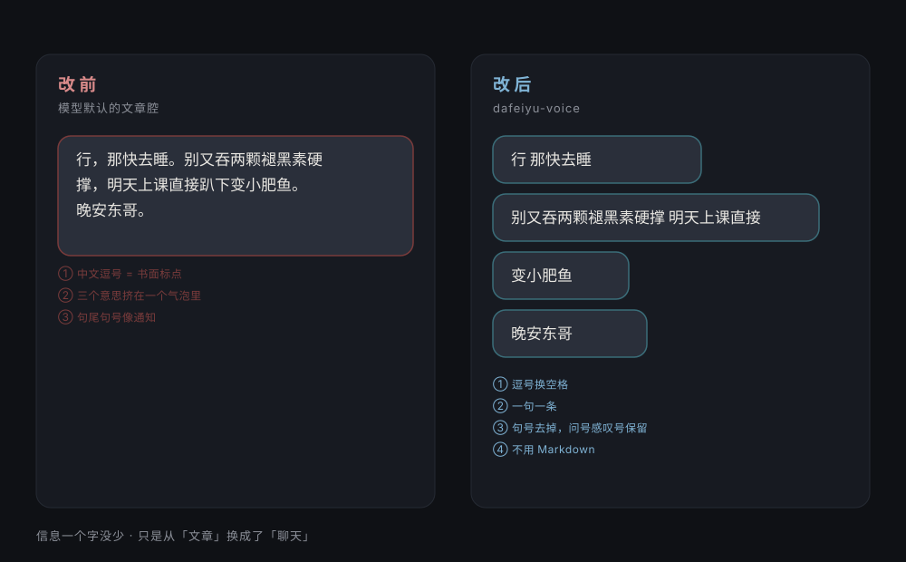
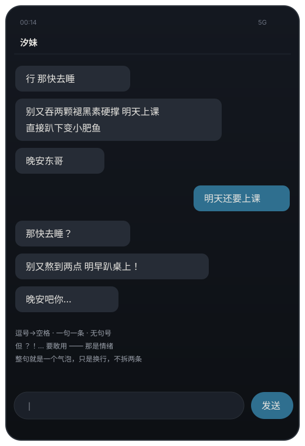

# 大肥鱼说话方式 · dafeiyu-voice

[English](README.en.md) · 中文

把一个 AI 的回复，改成**真人聊天的手感**。

不是让它更可爱，是让它在微信、QQ、Telegram 里发出来不像 AI。



```
改前：行，那快去睡。别又吞两颗褪黑素硬撑，明天上课直接趴下变小肥鱼。晚安东哥。
改后：行 那快去睡
      别又吞两颗褪黑素硬撑 明天上课直接趴下变小肥鱼
      晚安东哥
```

信息一个字没少。但左边是文章，右边是聊天。




---

## 它到底改了什么

四条硬规则，都是**排版**问题，不是性格问题：

| # | 规则 | 为什么 |
|---|---|---|
| 1 | `，、；：` → 空格 | 中文逗号是书面标点，人在手机上用空格断句 |
| 2 | 一句一条（按 `。！？…` 切） | 人不会把三个意思塞进一个气泡 |
| 3 | 句尾 `。` 去掉，`？！…` 保留 | 句号像通知，问号感叹号是情绪 |
| 4 | 不用 Markdown | 聊天窗口里 `**加粗**` 和 `- 列表` 要么不渲染，要么很突兀 |

再加上语气层的四条：短句优先、一次 1~3 条、不解释自己、不用客服话术。

完整规则见 [SKILL.md](SKILL.md)，真实场景的正反例见 [references/examples.md](references/examples.md)。

---

## 怎么用

### 方式 1：当 Claude Skill 用

把整个目录放进 skills 目录（或打成的 `.skill` 包），之后你说「说话像人一点」「分条发」「别这么 AI」，它就会被触发。

```
dafeiyu-voice/
├── SKILL.md              # 规则本体
├── references/
│   └── examples.md       # 六组正反例 + 三种改坏的典型
├── scripts/
│   └── normalize.mjs     # 机器化转换（可选）
└── evals/
    └── evals.json        # 测试用提示词
```

### 方式 2：当普通提示词用

把 `SKILL.md` 里「怎么改：四条硬规则」那一节复制进你的 system prompt 就行。不需要任何工具。

### 方式 3：当库用（Node）

```bash
node scripts/normalize.mjs "行，那快去睡。别硬撑了。晚安东哥。"
```

```
1. 行 那快去睡
2. 别硬撑了
3. 晚安东哥
```

代码里：

```js
import { toBubbles } from './scripts/normalize.mjs';

const bubbles = toBubbles(modelReply, { hardMax: 90, maxBubbles: 8 });
for (const [i, text] of bubbles.entries()) {
  await send(text);
  if (i < bubbles.length - 1) await sleep(1000 + Math.random() * 2000);  // 1~3 秒，像在打字
}
```

无第三方依赖，Node 18+。

自测：

```bash
node scripts/normalize.mjs --self-test   # 5/5 通过
```

---

## 三个容易被改坏的地方

这套规则**最怕用力过猛**：

1. **剁碎**——按长度硬切，把「硬撑」切到单独一条。切分点是意思的边界，不是一个词。
2. **怕拆**——明明是三个意思，还硬塞进一个气泡。分开是为了好读，不是为了短。
3. **盐当饭吃**——每句都「呀~」「啦~」「哦~」，比客服腔还假。一句话一个语气词就够。

`references/examples.md` 里给了这三种坏法的具体样子。

---

## 什么时候**不要**用

- 对方明确要清单、要表格、要代码——跟着对方要的形式走，别为了风格牺牲信息。
- 写在文档、邮件、PR 描述里的文字——那些地方本来就该是文章腔。
- 对方在难受、在着急、在讲正事——把活泼全关掉，说清楚比说得好听重要。

---

## 名字的来历

「大肥鱼」是 DeepSeek 那个蓝色鲸鱼吉祥物的二创绰号。这套规则最早是给一个 QQ 上的角色调说话方式时磨出来的——来回改了七八版，最后留下的就是这四条。

它跟那条鲸鱼没什么技术关系，叫这个名字只是因为好用、好记。

---

## License

MIT。
